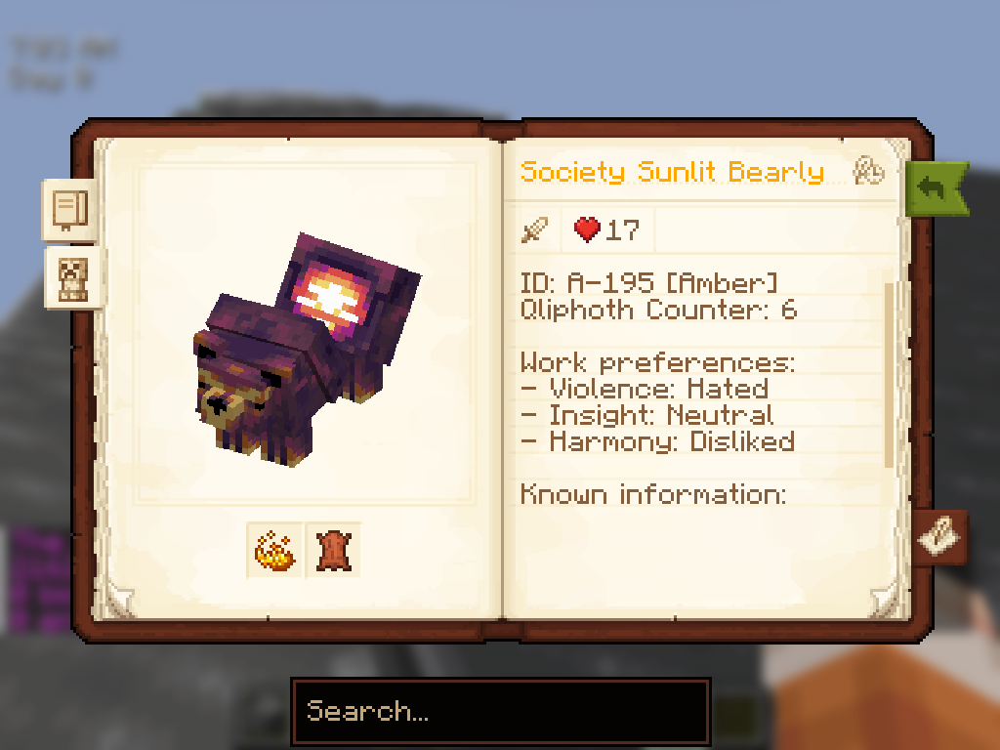

# 阳光谷 2.0 - 开发日志 #2 - 次要内容
- 发帖日期：2026年10月7日
- 原贴地址：[Discord](https://discord.com/channels/1322431115339894925/1369360467935625257/1557061925718986763)
--- 
- 如果你一直关注着阳光谷的开发，或许会注意到一个规律：我几乎每隔一次更新就会岔开话题搞点副项目。最近的 Secure Contain Profit 整合包就是例证，而这也可追溯到整合包的最早期——当时我做华丽史莱姆就是为了从阳光谷"休息一下"。
- 无论好坏，阳光谷都牢牢占据着我的注意力，而社区的热情也意味着：当我说我所做的一切都是为了阳光谷（只是开发层面，别害怕）时，我是认真的！阳光谷确实是一场马拉松，它是个耗费了大量时间与心血的大型整合包，但长时间埋头同一件事真的会让你视野受限，阻碍你尝试新想法。与此同时，我喜欢学习新东西、作为开发者挑战自己，这也是我的一大动力。从华丽史莱姆到温馨咖啡厅，质量和复杂度的差距如今已经非常明显了！
- 所以我想，不妨回顾一下我的一些副项目，聊聊我是如何把从中学到的经验用在阳光谷上的——毕竟这才是你们大多数人来看的原因嘛。

## Splendid Slimes - 华丽史莱姆模组
- 制作整合包有时和制作模组很像，但更多时候并非如此：在整合包开发中，你常常得用取巧或非常规的手段来实现效果，而非标准做法。我常说，做整合包是通往做模组的一条绝佳路径，而华丽史莱姆就是第一个这样的"练兵场"。当然，我此前已经有一版可靠的露珠耕地 - 生长版了，但那个模组本身是个分支版本，而且除了模组兼容代码之外也相对简单（那段代码当时还不存在）。
- 《星露谷物语》确实有史莱姆机制，但在我看来，这些机制既不太契合游戏本身，对玩家而言也普遍不够直观。它们给人感觉没怎么经过深思熟虑——如果你问一个普通星露谷粉丝有没有造过 Slime Hutch，答案多半是"没有"，或者"造过但没用过"。既然我并不是要做《星露谷物语》的 1:1 复刻，我认为采用 史莱姆牧场 的机制能为体验带来新鲜感。
- 这也坚定了我此后制作模组的理念：除了整合包专属模组之外，我做的每个模组都应当能在整合包之外游玩，因此它必须是独立完整的模组。这带来了一种高度数据驱动的做法，可以用数据包创建自定义史莱姆——这一模式如今被我用在了诸多模组中。（顺便一提，你知道可以让史莱姆生气时执行命令吗？）
- 我现在提起这些，是因为 2.0 中的许多机制正被重制为模组！这主要是出于稳定性和"用正确的方式做事"的考虑，而这确实会影响整合包性能等方面，也方便其他整合包开发者使用。目前鱼塘、果树和工匠机器正在开发中。畜牧可能也会有一个！

## Sunlit Cobblemon - 阳光方可梦整合包
- 不知道大家有没有意识到，阳光方可梦是我私下测试整合包改动的地方——那些我不敢直接在大舞台上做的改动，通常是些不看代码就察觉不到的技术性改动。不过在玩法层面，我想在方可梦版本里尝试两件事：
### 让稀有材料保持稀有
- 阳光谷 1.0 存在一个很棘手的重大问题：什么都不稀有。得益于技能树节点提供了获取途径（比如友谊项链），五彩碎片非常容易刷取。毛绒玩偶毁掉了铱、银、钓鱼凝胶等一切通常稀有资源的价值。对玩家来说这未必是坏事，但它带来了设计上的难题：如果我想让某样东西难以制作或获取，除了凭空发明一种新的超稀有材料之外就别无他法，这有点荒唐。
- 阳光方可梦在很大程度上用神秘树枝和阳光联盟勋章解决了这个问题。如果你没玩过这个整合包，你只需知道这两种资源主要通过对战获取，而玩家想要的许多稀有物品都要大量消耗它们。这既保持了稀有物品的稀有性，又在无意间让多人游戏经济变得稳固，因为它们始终有需求（这是个不错的副作用，不过我平时并不怎么考虑它，因为我为单人模式开发）。
- 这并不是说五彩碎片或银这类物品就不该自动化。相反，我认为这些资源的自动化应当需要你投入大量基础设施，而不是给一只火烈鸟戴上昂贵的项链就完事。大量投入钓鱼应当让获取凝胶更容易，而不是把它们塞进玩偶里。这是我在 2.0 中更加谨慎对待的问题。
### 无限扩展及其对人类的后果
- 在《星露谷物语》里，有一种资源是有限的：空间。即便你在镇上各处塞上一千个腌制罐，也终会耗尽空间。这一机制并不适用于 Minecraft。许多人设想过去实现这一点的办法（尤其在 hardcore thread 里），比如税收系统、花钱圈占土地，甚至是记录你放置了多少台某种工匠机器并加以限制。这些在我看来都相当蠢且随意。
- 阳光方可梦是我能想到的最接近以合理方式实现该系统的做法：每个宝可梦工人都为一个上限做贡献，而该上限随你的训练家水平提升而提高。作为补偿，工人们相比阳光谷中的对应物强得离谱——你可以饲养一只每天给你 6 个优质绒毛之类的离谱宝可梦。这让事情更像一种取舍，你无法靠无脑堆量蒙混过关。严格来说有办法永久提高工人上限，但它被上述稀有资源所限定。这套系统行之有效，但在我心里仍觉得相当随意。
- 2.0 会对动物设硬性上限吗？大概不会。但我正考虑采用一套谷仓与鸡舍系统，每个谷仓按等级设有动物数量上限，而不是像 1.0 那样依赖繁琐的拥挤机制，还得操心碰撞箱之类的技术细节。

## Secure Contain Profit - 作者为秋季整合包创意大赛开发的SPC怪物养殖整合包
- 很遗憾（对你们而言），我必须将许多内容保密至之后的开发展示，但我其实正为阳光谷在 SCP 中测试不少东西。概念上，monster ranching 一直是我有点想加入阳光谷的东西，但我始终想不出办法将它与普通的畜牧和史莱姆区分开。SCP 让我确信，这类东西并不适合当作整合包里的支线玩法——整个整合包必须围绕它构建，否则机制格格不入。
- 除了概念本身，我还测试了不少模组，有些进入了最终成品，有些则被淘汰。我非常想尝试的一点，是用 Field Guide 替代农夫年鉴！这个模组有大量自定义选项，我还写了个脚本生成异常数据，供阳光谷用于作物和动物数据等内容。如果你没玩过 SCP，以下是预填数据后页面的样子：

  

## 结语
- 这个话题我能聊上很久，但我已经打了约一千字，你们才不会全读完！！我尤其想聊聊入门整合包开发，因为我热衷于鼓励大家练习创作、做自己感兴趣的东西——但那是改天的话题。
话虽如此，我在 2.0 中做的大部分工作只是把现有内容重做、打磨得更完善，所以目前还不太适合拿出去展示。不过这可能很快就会改变，敬请期待！

