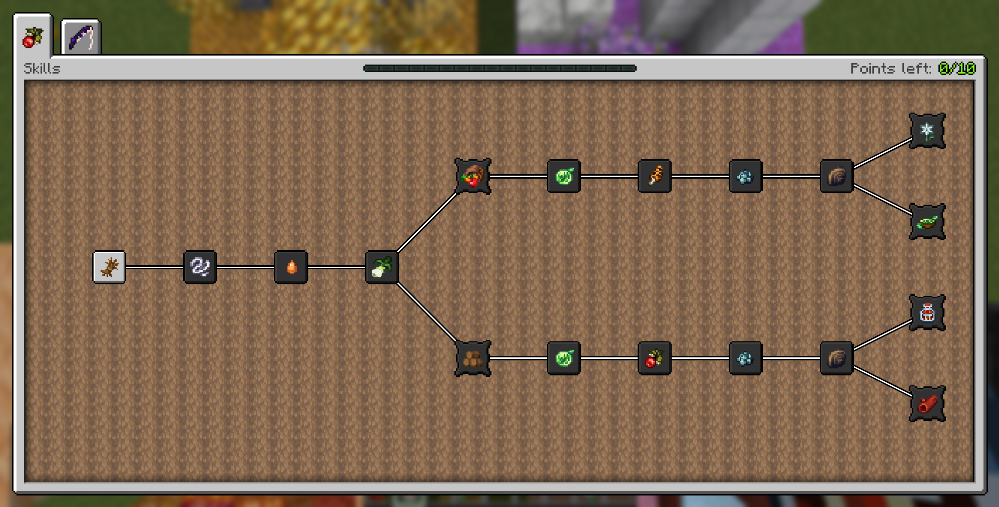
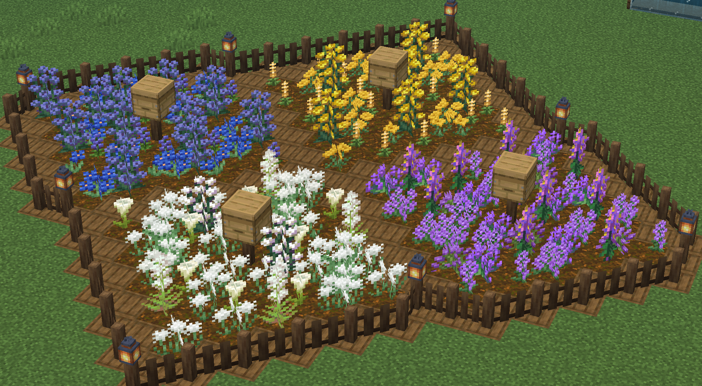
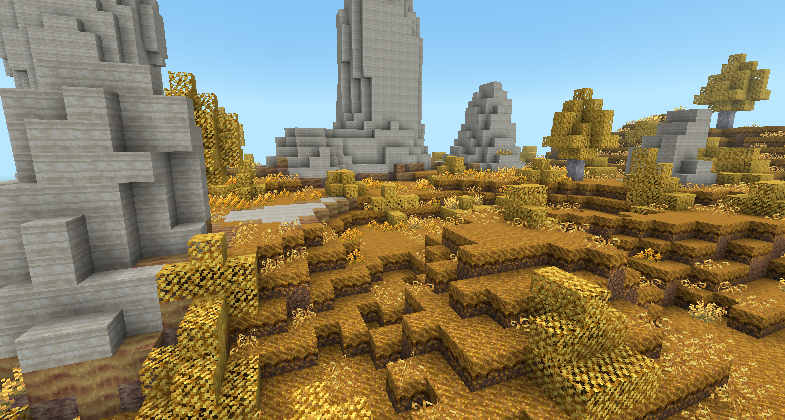

# 阳光谷 2.0 开发日志 3 - 采集前瞻
- 发帖日期：2026年11月5日
- 原贴地址：[Discord](https://discord.com/channels/1322431115339894925/1369360467935625257/1567622103560097965)
--- 
- 采集在阳光谷一直有点尴尬。它算是存在，但总让人觉得说不上哪儿别扭。到处搜罗南瓜、干草捆和浆果灌木，收获不错，也挺赚钱。它鼓励玩家在前期探索，同时给玩家一笔可观的启动资金，让农场运转起来。对老玩家来说它更重要，因为它能让他们凭以往的经验跳过前期大部分枯燥劳作，从而提升整合包的可重玩性。
- 可到后来，它就不算一项玩法了。到了某个阶段，你不再去打碎浆果灌木。也没有星露谷物语那样可供升级的技能，让采集在整合包里更有分量。下界和骷髅洞穴几乎不提供任何采集内容。论最优解，大规模农业终究会笑到最后，但采集早该迎来一次提升，让它变得更有趣，成为真正能让人感知到的环节！

## 什么是采集？

- 想做好采集，得先弄清它现在是什么、我们想让它变成什么。目前 SSV 里的采集，指的是从世界里随手捡拾可出售的物品，通常是浆果、南瓜和干草捆。此外还有一些杂项采集品，比如板栗、贝壳和蘑菇。
- 作为灵感来源的星露谷物语，还把树木、花朵，以及——呃——树液采集器，也算进了这一类。不过我们可以做得更好！飞蛾与蝴蝶、蜜蜂以及其他昆虫同样符合这个定义。另外还有一些主世界的杂项资源，比如草秆、树脂、丝茧等等，其实都能在机制层面更深入地融进整合包！

## 采集点与技能

- 现在采集的一大毛病是：
  - 附近的可采集物迟早会被你清空，之后你就再也不会去碰这套系统。采集点就是我给出的答案——让浆果灌木这类东西随时间重新长出来，这样隔三差五进林子转转才更划算。它们在我还没公开的那个超级秘密群系里还会有特殊效果。顺带一提，为支撑这套新系统，目前还有约 14 种新的可采集物正在开发中。
- 至于技能，这大概值得单独写一篇开发日志，不过我想先简要过一遍技能树的改动。
- 斧头效率这类凑数的技能树节点不会再出现。技能节点会转向更有分量的内容，比如解锁某些材料的获取途径（很像星露谷物语的配方解锁系统）。
- 现在每条技能线各有 10 级，并取消了中途的路线选择，免得玩家挑花眼。
- 不少满级技能也重新做了平衡。例如：上古陈酿桶不再是技能树技能，多半会挪到流程更靠后的地方。
- 也正因为这些改动，遗憾水晶在新版本将会全额返还点数，调整起来将会更佳方便。
- 采集技能自然既能给农场带来新资源，也能提高这些可采集物的收益。技能树上半条线偏重采集点与蘑菇，下半条线专精树木、树液采集和野生果树。具体有哪些技能，得等第一次2.0测试版发布（至于什么时候，天知道）才见分晓，不过可以先给你们瞄一眼！

  

## 花朵与蜜蜂

- 花朵就是那种典型的、从我的世界和星露谷物语搬过来就"水土不服"的东西。在我的世界里它们是装饰性方块，也就是说它们到处都是。只要给它们定任何价值，平衡就会崩；而若为此简单粗暴地调低生成率，很多生物群系在观感上会差一大截。除此之外，玩家普遍不爱在我的世界里种花（部分原因是没有靠谱的自动补种手段——这个问题我们会解决）。
- 蜜蜂也有类似的问题，不过解决起来非常简单。工匠蜂蜜！2.0 会加入一种自定义蜂箱，它根据附近的花朵，每隔几天产出带风味的蜂蜜，类似蘑菇树桩和星露谷物语里的蜂箱。花朵那边，我想先留个悬念。我只想说，Dinkum（丁垦小镇）在这方面做得非常巧妙……

  

## 采集南瓜和干草捆是不是太强了？

- 社区里一直在讨论这个问题，新玩家尤其关心。既然聊到采集，就绕不开那些大南瓜。确实，它们可能有点超模，但也强不了太多。就像我之前说的，我认为它们对整合包的乐趣确实必要，所以我不打算让外出采集的整体收益掉太多。大概得点几级采集技能，才能追上现在 SSV 的采集效率，但技能树点满之后，收益应该会明显高出一截。你管这叫平衡也行。
- 话虽如此，我确实想加入野生版本的南瓜和西瓜，这样自己农场里种出来的才更划算。它们是非常独特的作物，可没人愿意种，但如果直接把价格提上去，南瓜又会强得离谱！

## 结语

- 我希望这些改动真能把采集做成整合包里一条有吸引力的玩法路线，尽管我估计大多数玩家仍会扑向葡萄酒、茶这类显而易见的农业流派。说实话，在把定义放宽到包含蜜蜂、蝴蝶和花朵之前，我设计采集时确实卡了很久。另外 Uni（开发者之一）正在为一个新的秘密地点设计世界生成，采集会在那里支撑起重要的玩法，这点也帮了大忙。要让那个地方有意思，就得保证采集是一口"永续炖锅"般的利润来源——姑且这么说吧。如果你对采集还有别的点子，请告诉我！

  

