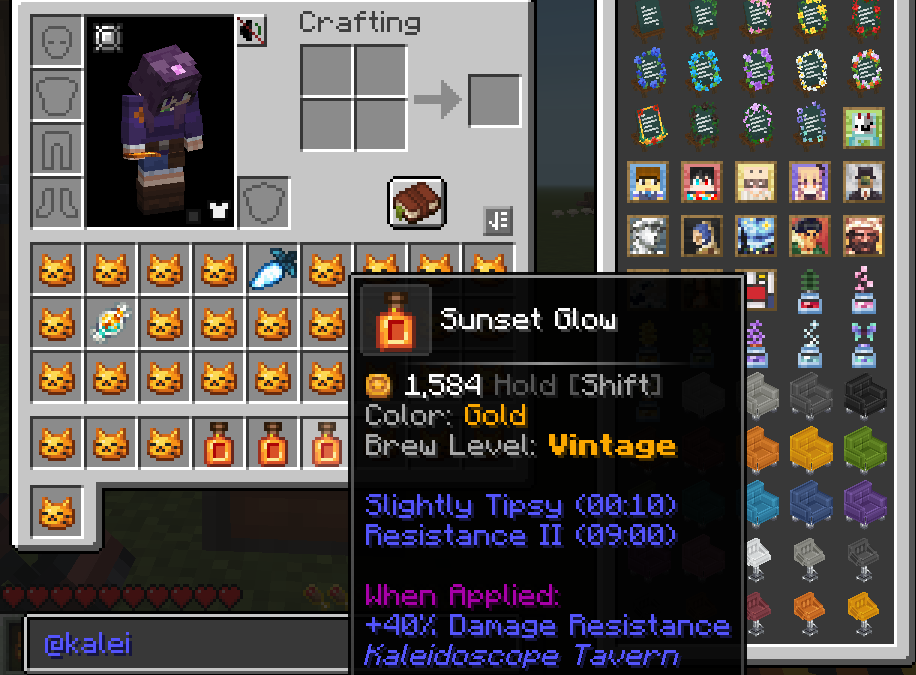
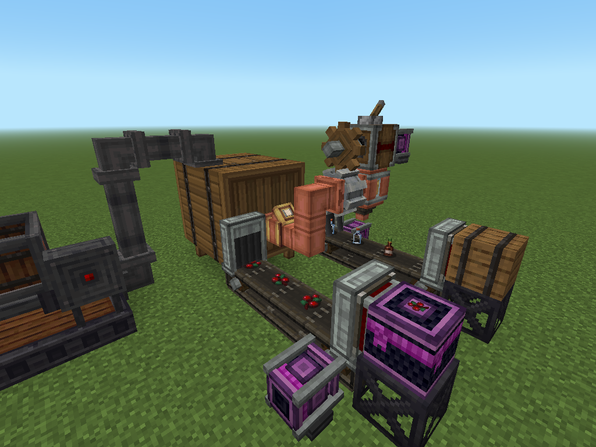
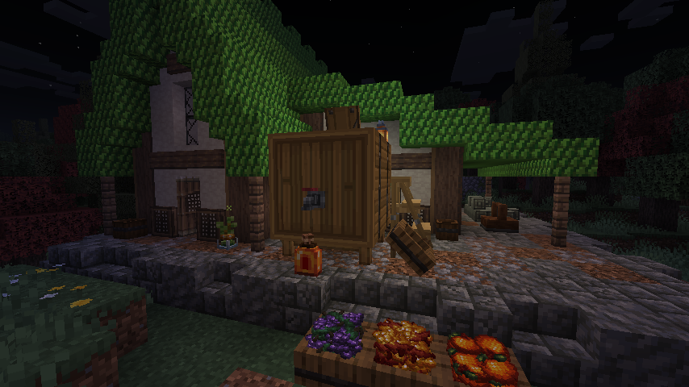

# 阳光谷 2.0 开发日志 4 - 葡萄酒
- 发帖日期：2026年11月23日
- 原贴地址：[Discord](https://discord.com/channels/1322431115339894925/1369360467935625257/1574129549023772773)
--- 
- 很多人都对 2.0 中葡萄酒的改动感到好奇，毕竟我一直在一点一点地透露消息。既然开发分支上的实现差不多完成了，不如现在就聊聊！先说最重要的一点：2.0 中酿酒模组将从**葡园酒香**换成**森罗物语：酒馆**！这两个模组对酿酒各有不同的诠释，各有优劣，不过我觉得森罗物语：酒馆的机制更适合阳光谷。话虽如此，我还是会怀念葡园酒香一些很棒的效果，因为其他模组里我没见过类似的设计！

- 换模组是一回事，但这还没解释它会怎么被添加进整合包！没错，高级酒桶和铱品质葡萄酒会因为模组被移除而一并消失，但新模组我打算怎么用呢？

## 品质（Brew Level）
- 和葡园酒香的陈酿机制类似，森罗物语：酒馆内置了一个机制来表示效果强度。葡园酒香里叫“年份”，取决于你制作它的那一天，这让葡萄酒堆叠起来有点烦。森罗物语：酒馆里叫“品质”，从“难以下咽”到“典藏”不等。和葡园酒香不同，它取决于你怎么酿，而且不会随时间变化！

- 在阳光谷 2.0 中，葡萄酒的品质会影响售价。难以下咽的葡萄酒价值 10%，普通为 100%（正常价格），典藏葡萄酒则为 400%！如果你数学不错，会发现典藏葡萄酒正好对应原先的“陈酿”版本，也就是说不再需要单独的“陈酿”物品形态了。

## 总结：
- **酒桶**始终酿造普通品质的葡萄酒。
- **陈酿桶**会把普通品质的葡萄酒提升到典藏品质。

- 那上古陈酿桶呢？这可能是葡萄酒玩法上最大的改动：上古陈酿桶不再需要耕种技能树里的技能。在玩家进入骷髅洞穴之后就能制作并使用它。至于效果，我其实是借用了星露谷物语的做法，直接让它们提升葡萄酒的星级品质。这意味着理论上你可以得到铱品质的普通葡萄酒，或者银品质的典藏葡萄酒。对休闲玩家来说，这基本和 1.0 没什么区别，但我觉得利益至上的玩家会乐于研究 2.0 中**时间:品质:星级品质**的最优比例！
  - 译者的话：
  - 注：森罗酒馆这个品质(Brew Level)可能会和阳光谷使用的品质(Quality)概念混淆，后面如果可能会考虑改森罗的文本。

  

## 高级酒桶去哪了
- 你可能会有两个疑问：“高级酒桶怎么办？”以及“难以下咽的葡萄酒怎么办？”换了一个新的酿酒模组，也就有了新的可自动化酿酒方案。森罗物语：酒馆的酿造系统有点不一样！流体和物品可以直接通过管道输入大酒桶，自动化容易得多，尤其是 2.0 还会加入一种设备，在收到红石信号时可以把指定数量的物品直接放进指定槽位。

- 大酒桶有趣的地方在于品质系统。开始酿造后，整个酒桶会立刻产出“难以下咽”的葡萄酒。这种酒基本不值钱，价值降低 90%，不过你实际上有两个选择：
  - 装瓶，然后用陈酿桶把品质提升到“典藏”
  - 留在酒桶里！随着时间推移，品质会逐步提升 6 个阶段，直至达到“典藏”级

- 我认为这给喜欢自动化和自动化挑战的玩家带来了非常有趣的选择。你是走简单路线，把难以下咽的葡萄酒直接扔进陈酿桶，承担火花石的成本？还是搞一套复杂的计时器系统来自动化生产典藏品质？

- 这张图来自我前段时间做的另一个整合包，它展示了一种简单的葡萄酒自动化方案。
  - 当然，我不会把沉浸工程加进阳光谷。

  

## 田园风还是工业化
- 希望这解答了你关于葡萄酒的所有疑问，如果你现在还有疑问的话！森罗物语：酒馆是一个非常漂亮且制作精良的模组，我很兴奋能把它用在阳光谷里。它提供的不只是葡萄酒，还有装饰方块，甚至鸡尾酒，我得想办法把它们整合进来！与此同时，我会非常怀念葡园酒香。它很多自己的东西都做得很好，即使我对高级酒桶有意见。无论如何，我希望休闲玩家和自动化玩家都会喜欢这些葡萄酒改动！要同时讨好两边并不容易，但每次我成功找到平衡，我都很开心！

  

